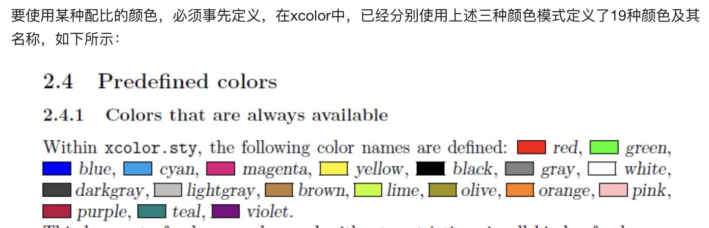

# Latex

latex 教程

[LaTeX 新手教程：从入门到日常使用](https://zhuanlan.zhihu.com/p/456055339)

## Packeage

- ctex

中文支持

- color,xcolor



- listings

代码块支持

- fancyhdr

页头、页脚

- subfigure

插入图片

- tikz-flowchart

画流程图，提供基础图形，默认白色

## 编译

### 编译顺序

在LaTeX中，文档的编译过程通常需要多个步骤，因为LaTeX在处理文档时需要多次计算，以确保所有交叉引用、目录、参考文献等都正确地显示

1. LaTeX编译：首先运行LaTeX编译器对源文件进行编译，生成一个DVI（Device Independent）文件。在此过程中，LaTeX将源文件中的所有命令和文本转换为可视化的输出，并生成文本样式、目录、参考文献等信息。
2. BibTeX编译：如果文档中包含参考文献引用，需要运行BibTeX编译器来处理文献数据库（.bib文件），并生成一个包含参考文献列表的BBL（BibTeX Bibliographic References）文件。
3. LaTeX编译：运行第二次LaTeX编译器，此时LaTeX将读取之前生成的BBL文件，并在文档中插入正确的参考文献引用。
4. LaTeX编译：运行第三次LaTeX编译器，此时LaTeX将正确地引用参考文献，并生成完整的目录和交叉引用，以及其他任何需要的信息。
5. PDF编译：最后一步是将DVI文件转换为PDF文件。这可以使用一个独立的程序，如dvipdfm或者使用直接的pdfLaTeX编译器来完成。

### vimtex

vimtex 使用 latexmk 编译

指定编译器， 通过宏定义， 也就是在文件开头， 加上类似命令 `% !TEX program = pdflate/xelatex` - 多次编译多行指定

多个文件设定主文件， 通过宏定义， 加上主文件的路径， 比如 `% !TEX root = ../main.tex`

## 画图 Tikz

[LaTeX—Tikz 宏包入门使用教程](https://zhuanlan.zhihu.com/p/127155579)

## MacOS配置latex 环境

```sh
brew install mactex-no-gui
pdflatex xxx.tex
xelatex xxx.tex
```
